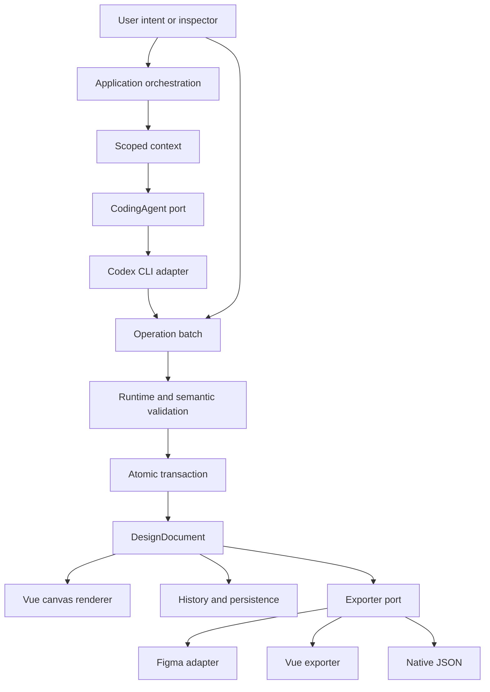

# Pudly execution brief

Recorded 2026-10-04. Status: foundation planning; implementation not accepted.

## 1. Repository assessment

The supplied workspace was empty, with no Git metadata, source, package manifest, tests, or project instructions. Git has now been initialized without commits or remotes. No infrastructure was overwritten. Node 26.8.1 and npm 11.19.0 are available. Vue, TypeScript and testing infrastructure must be established after specification review. The original directive is preserved in master-build-directive.txt.

## 2. OpenSpec workflow

Installed OpenSpec is 1.9.0. Initialized with `openspec init --tools codex --no-animation --no-copilot-cloud`; the installed CLI generated the spec-driven schema and Codex skills under .agents/skills. Use proposal → specs + design → tasks → apply → verify → archive. Inspect `openspec instructions <artifact> --change <name> --json` before authoring an artifact. Validate using `openspec validate --all --strict --no-interactive`. Archive only after implementation and acceptance evidence exists. Artifact completion alone does not mean implementation completion.

Initial change: design-engine-foundation. It specifies document, operations, canvas, agent runtime, design systems, history/persistence, exports, and MVP behavior. Later changes may extend these capabilities; they must explicitly update contracts before code diverges.

## 3. Codebase MCP

The user selected DeusData/codebase-memory-mcp and authorized installation. Native v0.11.0 is installed locally with its published release checksum verified. Project-scoped configuration and a root/cache-isolating launcher are present; the prior @tr4n2uil installation and configuration were removed. No global configuration changes remain. Real MCP initialization and tools/list succeeded with 17 tools. A temporary TypeScript fixture proved graph semantic retrieval, then a symbol rename proved refresh; the fixture was removed and the workspace refreshed.

Coordinator independently verified the repository root, index status ready, 256 nodes/255 edges, no partial or unusable parsing, and exclusions for .git/.codex-design. Indexed code search retrieved the exact operation-batch specification section. Natural-language semantic retrieval currently returns no product symbols because product code is not yet implemented; this is a code graph, not a general document-passage search engine. See codebase-mcp.md for reproducible commands and qualifications. The current chat tool inventory cannot gain a newly configured server mid-turn; the native CLI exposes its real tools for indexed discovery now, with project MCP activation on a later session reload.

Refresh after substantial changes with index_repository; validate freshness and root with index_status, then verify known symbols against actual source. The repository remains authoritative. Do not count infrastructure health as product architecture retrieval coverage until real source and tests exist.

## 4. Product interpretation

An intent-driven design engine whose structured, framework-neutral document feeds an interactive renderer and multiple exporters. AI and inspector edits share a mutation pipeline. A generated application is an export artifact. The first delivery proves the vertical invariant before developing a sophisticated editor.

## 5. Design IR

Versioned document with stable IDs, revision, pages, node map, token dictionary, component definitions and metadata. A page owns ordered root IDs. Each node has one owning parent, except page roots. Types: frame, group, text, image, icon, vector, component-instance. Component definitions own separate template trees; instances refer to definition + variant and validated property overrides. Template IDs are namespaced; expanded render IDs are derived and do not become persistent mutable document nodes.

Layout describes horizontal/vertical/free arrangement, alignment, gap and padding as typed measures (literal or token). Sizing is fixed/fill/hug with min/max bounds. Styles describe semantic paint, typography, corner and effect references, never arbitrary CSS. Constraints describe anchors in free layout. Responsive rules are ordered breakpoint overrides of layout/sizing/visibility; overlapping equal-priority rules are rejected. Images use asset references; icons use named library identifiers; vectors use validated path data, never injected markup.

A versioned schema rejects cycles, duplicate ownership, dangling children, token/type mismatches, invalid variants, nonfinite geometry, excessive depth/count and unsupported versions. Migration is explicit; newer unknown versions fail without replacing stored state.

## 6. Operation protocol

Discriminated serializable operations with explicit IDs and values: create/delete/move/duplicate node, set property/layout/style/token/constraint, group/ungroup, create/delete/rename page, create component/instance, detach, create/set variant. Start with create/delete/move and property/layout/style edits in the walking skeleton; capability negotiation exposes only implemented operations.

Batch carries ID, document ID, expected revision, source and operations. Validate runtime shape, authorization/scope, each operation and the final graph on an isolated draft. Commit once, increment revision once, record audit metadata and before/after snapshots. Any failure discards the draft with indexed diagnostics. Concurrent stale revisions reject; duplicate batch IDs cannot apply twice. No arbitrary JSON paths, executable code or prototype property assignments.

## 7. Boundaries

Domain: document, operations, tokens/components and validation. Application: transactions, selection, history, context and run orchestration. Adapters: Vue renderer, local persistence, Codex process, repository index, native/Vue/Figma export. Domain imports no Vue, browser DOM, Node process, MCP or Figma SDK. The desktop/local server owns trusted filesystem and process access; browser invokes a bounded localhost API.

## 8. Architecture

## 9. ADRs

See docs/adr for ten concise decisions. These are proposed foundation decisions, subject to independent falsification before implementation.

## 10. Testing

Strict TypeScript. Vitest domain unit + integration tests, Vue component tests, Playwright actual browser tests, lint and production build. Trace each critical scenario to named tests. Adversarial tests cover invalid final graphs, failed middle operation, mutation aliasing, stale responses, cancellation races, token mismatch, exporter escaping and persistence failure. A controlled CLI fixture verifies adapter lifecycle only; live Codex generation is a separate required evidence gate and cannot be replaced by a mock.

## 11. MVP milestones

M0 reconnaissance + real index health; M1 reviewed contracts and validated specs; M2 test/build/lint foundation; M3 real prompt → operations → commit → Vue canvas; M4 selection/inspector/contextual prompting; M5 undo/redo/snapshots/restore + persistence; M6 tokens/components/variants/responsive frames; M7 native + Vue + Figma exports; M8 adversarial E2E, visual, accessibility, security, performance and architecture review. Full MVP requires all 20 directive capabilities. No milestone is accepted with required gates failing.

## 12. Parallelization

Coordinator freezes shared contracts before dependent implementation. Separate owned paths: domain, runtime adapters, renderer/UI. Three concurrent Luna slots at most, with QA assigned after a slot frees. Worktrees require a baseline commit; until then use explicit nonoverlapping ownership. Never let an implementer approve their own major feature.

## 13. Initial Luna assignments

Specification reviewer: attempt to falsify the proposed contracts and acceptance scenarios, read-only report. Codebase feasibility investigator: identify available configuration without changing global settings. After blockers resolve, domain implementer owns src/domain and domain tests; runtime implementer owns src/adapters/codex and server; canvas implementer owns src/ui. Each assignment references the reviewed change, contracts and evidence commands. Independent QA follows each implementation.

## 14. Risks

Codebase identity/availability; CLI subprocess compatibility (local CLI is logged in using ChatGPT); valid JSON with invalid semantics; stale generation overwriting manual edits; cancellation after commit; component expansion cycles; persistence quota/corruption; export feature loss; unsafe localhost access. Mitigate through explicit integration verification, revision checks, isolated transactions, lifecycle guards, bounded validation, atomic saves and loss reports. No secrets in browser, logs or design document.

## 15. Figma feasibility

Session exposes Figma file creation, JavaScript execution in file context and asset upload. A read-only whoami check confirmed an authenticated account with a Full seat. This does not prove successful export or write permission to a target file. A target file is not supplied. The planned first-class export adapter maps semantic frames/layout/text/components/tokens directly to Figma nodes and reports unsupported features; it must not capture screenshots or recover semantics from DOM. A user-run Figma plugin importing native JSON is an alternative portable external path. Write permissions, mapping fidelity and an actual export remain unverified. Load relevant Figma skills before execution; no Figma writes performed during reconnaissance.

## 16. Walking skeleton

Create empty project → submit prompt → safe read-only Codex process with JSON schema → parse final response → bounded operation validation → revision-aware atomic commit → visible Vue nodes → stable-ID selection → contextual prompt edit. Record operations and before/after revision. Prove failures leave state unchanged. Then verify snapshot → edit → undo → redo → restore with a real reopened project.

CLI contract inspected: codex-cli 0.154.0 supports `exec`, stdin prompts, `--json`, `--output-schema`, `--ephemeral`, and `--sandbox read-only`. Spawn with executable + argument array, shell disabled, prompt over stdin, isolated working directory, output and timeout limits, AbortSignal termination and exit diagnostics. Process exit zero is not design success. Official reference: https://learn.chatgpt.com/docs/non-interactive-mode (checked 2026-10-04); installed help controls version-specific flags.
